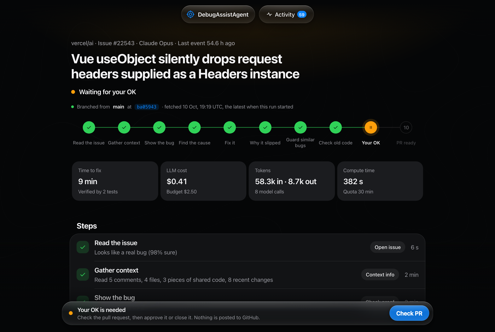

# DebugAssistAgent

## [Run it on a real bug →](https://debugassistagent.onrender.com)

**A bug report comes in. DebugAssistAgent writes a test that fails because of it, finds the cause, and writes a fix that two separate tests must pass. Then it explains how the bug slipped through (conditions, never people) and adds a guard for bugs like it. Nothing reaches GitHub until you approve the exact text.**

**Live:** [start a run](https://debugassistagent.onrender.com) · [how it works](https://debugassistagent.onrender.com/how) · [system check](https://debugassistagent.onrender.com/checks). Sign in with GitHub; accounts are by invitation.

**Every run starts from the latest main.** The run reads main's newest commit, moves its own copy of the code there, and says so at the top of the page ("Branched from main at ba05943 · fetched 10 Oct, 19:19 UTC"). The test machine is rebuilt only when the package list changed. A package the bug needs but the machine lacks is installed only after you say yes.

**Advisors review four steps through MCP, and you decide.** Advisor seats on the Domain Expertise MCP server check the triage, the cause, the report and the guard. When one disagrees, the run pauses before the next step and shows both plans side by side; you choose whose plan it follows. Only what we sent the advisor can come back into a prompt: our own repo files, our own report's sentences.

**Laya triages; Claude fixes.** Laya, a triage model fine-tuned for this, decides whether the issue is a real bug. Claude Opus writes the tests, the cause and the fix. Every test runs with the network off: in E2B sandboxes when hosted, in Docker on a Mac.

**Result:** on 2 of 2 bugs compared with the maintainers' own fixes, the cause was the same lines they changed. Our fixes passed every test DebugAssistAgent wrote, but not every test the maintainers wrote ([below](#result)).



## The problem

A maintainer gets a bug report. Before anyone writes a fix, someone has to make the bug happen on purpose, find the lines that cause it, and prove the fix works without breaking anything else. vercel/ai, the repo we test on, opened more than a hundred new issues in two days this week.

AI fixers mostly stop at a patch that makes the reporter's example pass. That fails in two quiet ways. The patch is narrow: it passes its own test and misses the cases a maintainer would have tested. And nobody records why the bug got through, so the same kind comes back.

## What it does

Ten steps in a fixed order, each checkpointed, so a crash resumes where it stopped.

1. **Read the issue:** Laya decides whether it is a real bug, and how sure it is.
2. **Gather context:** comments, linked PRs, error lines, the files that match the issue's exact strings, how other packages do the same thing. No AI.
3. **Show the bug:** a new test that fails on main *for the issue's reason*. A crash or a wrong failure does not count.
4. **Find the cause:** the file and lines, read from the failing test's output.
5. **Fix it:** the smallest change that turns that test green with every affected test suite still passing, confirmed by a second test written without seeing the fix.
6. **Why it slipped:** the conditions that let it ship, from the line's history on GitHub. Never a person.
7. **Guard similar bugs:** one test over every way this kind of bug can happen.
8. **Check old code:** would the guard have caught it when it was written?
9. **Your OK:** the pull request as GitHub would show it: description, files, tests, commit message. You approve or close it.
10. **PR ready:** the text and the change are saved. Nothing is posted for you.

It decides on evidence, not on the model's word: a fix counts only when tests that failed on main pass with it.

## Result

Each fix compared with the maintainers' own, on the same commit the run used, with the network off:

| Bug | Cause | Our tests on our fix | Maintainers' tests on our fix |
|---|---|---|---|
| [#22085](https://github.com/vercel/ai/issues/22085) WorkflowAgent drops provider tool results when the output is cut off | **Same lines** as the merged fix [#22093](https://github.com/vercel/ai/pull/22093) | 2 of 2 pass | 56 of 59 pass; **3 of their 4 new cases fail** (a broken local tool call in the same step) |
| [#22543](https://github.com/vercel/ai/issues/22543) Vue `useObject` drops headers given as a `Headers` instance | **Same lines** as the open fix [#22545](https://github.com/vercel/ai/pull/22545) | 2 of 2 pass; the whole vue suite passes (58) | **Fails** their case of a `Headers` instance that sets its own content type |

**We report the maintainers' tests because our own would flatter us.** Both fixes passed every test DebugAssistAgent wrote; neither passed all of the maintainers'. In both cases the cause was right and the fix too narrow: it patched where the symptom showed instead of reusing the code the repo already had. Since then, the fix step is shown how other packages and the repo's own helpers do the same thing, and fix PRs named in the issue's discussion. The next step is to run the upstream fix's tests against every fix before your OK.

The #22543 run: 9 minutes, $0.41 of AI, 8 model calls. Method and full outputs: [`docs/RESULTS.md`](docs/RESULTS.md).

## Run locally

Needs Python 3.12 (uv), Docker, and your own keys in `.env`.

```bash
git clone https://github.com/ishamishra0408/DebugAssist && cd DebugAssist
uv sync && git config core.hooksPath .githooks
uv run pytest                                   # 315 tests
cp .env.example .env                            # fill it in yourself; it is git-ignored
docker compose up -d                            # MongoDB and Phoenix, localhost only
uv run debug-assist serve --port=8777           # http://127.0.0.1:8777
```

Hosting it (Render, E2B, MongoDB Atlas, Laya through Tailscale): [`deploy/DEPLOY.md`](deploy/DEPLOY.md). Commands, guardrails and troubleshooting: [`docs/OPERATIONS.md`](docs/OPERATIONS.md).

## Repo map

```
src/debug_assist/   the pipeline and the web app
  graph.py          the ten steps, the pauses (install, advisor, your OK), resume
  context.py        Gather context
  testwriter.py     Show the bug, and the check that a test fails for the issue's reason
  fixer.py          Find the cause, Fix it, the second test
  story.py          Why it slipped
  guard.py          Guard similar bugs
  backtest.py       Check old code
  advisors.py       the advisors on the Domain Expertise MCP server
  fresh.py          every run on the latest main
  pkgcheck.py       a missing package, installed on your yes
  server.py         the home page, sign-in, the APIs
  viewer.py         the run page
tests/              315 tests; a commit is refused while any fails
deploy/             Render, E2B and Laya setup
scripts/            base checkouts, the E2B template, a doctor for the local setup
training/           Laya's triage fine-tune
docs/               results, operations
```

Built with Claude Code. GitHub access is read-only: the pipeline holds no write credential, and publishing a pull request is a step you take yourself.
